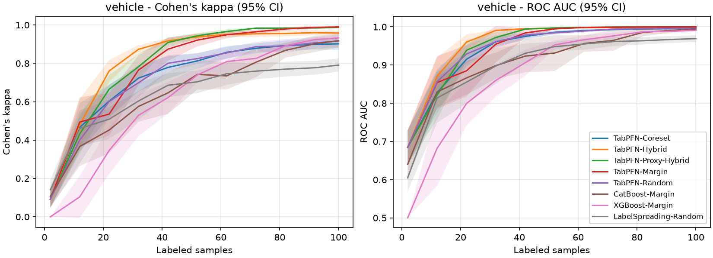

## Reproducing benchmark from the paper
The benchmark runs 8 methods of the paper on the 20 OpenML datasets of Table I with 10 different seeds.

For each seed, the dataset is subsampled to 10,000 rows if larger. Then split into a stratified 70/30 pool/test split shared by all methods, as is the initial context.
```bash
# all datasets and methods
python -m tab_aicl.benchmark run --output results/results.csv

# a subset / any OpenML dataset by its ID
python -m tab_aicl.benchmark run --datasets iris vehicle 1494 --methods TabPFN-Hybrid TabPFN-Random CatBoost-Margin --seeds 5

# Tables II, V/VI and III, and the learning curves of Figs. 2-5
python -m tab_aicl.benchmark summarize results/results.csv --compare TabPFN-Hybrid CatBoost-Margin --plot vehicle
```
Log each finished run to the CSV. An interrupted benchmark resumes where it stopped.
Use `--batch-size` for the ablation of Table IV and `--metric roc_auc` to summarise ROC AUC instead of Cohen's kappa.

| Method | Estimator | Strategy |
|---|---|---|
| TabPFN-Coreset, -Hybrid, -Proxy-Hybrid, -Margin, -Random | TabPFN, `n_estimators=32` | as above |
| CatBoost-Margin | CatBoost, 2000 iterations, learning rate 0.05, depth 6 | margin |
| XGBoost-Margin | XGBoost, 2000 trees, learning rate 0.05, max depth 6 | margin |
| LabelSpreading-Random | Label Spreading, 7-NN kernel, α = 0.2 | random |


The same functions are available from Python in `tab_aicl.benchmark` (`run_benchmark`, `summary_table`, `compare`, `plot_learning_curves`).

### Results of this implementation
Normalized AULC of Cohen's kappa up to 100 labels (mean ± std over 10 seeds, batch size 10, `tabpfn` 6.2.0), next to Table II of the paper:

| Method | Ionosphere (ours) | Ionosphere (paper) | Vehicle (ours) | Vehicle (paper) |
|---|---|---|---|---|
| TabPFN-Coreset | 0.416 ± 0.161 | 0.617 ± 0.132 | 0.738 ± 0.049 | 0.742 ± 0.067 |
| TabPFN-Hybrid | **0.786 ± 0.035** | **0.810 ± 0.042** | **0.829 ± 0.029** | **0.833 ± 0.022** |
| TabPFN-Proxy-Hybrid | 0.764 ± 0.049 | 0.800 ± 0.032 | 0.816 ± 0.041 | 0.811 ± 0.054 |
| TabPFN-Margin | 0.771 ± 0.064 | 0.788 ± 0.038 | 0.797 ± 0.063 | 0.794 ± 0.040 |
| TabPFN-Random | 0.736 ± 0.061 | 0.751 ± 0.052 | 0.733 ± 0.037 | 0.747 ± 0.052 |
| CatBoost-Margin | 0.641 ± 0.085 | 0.641 ± 0.051 | 0.656 ± 0.101 | 0.665 ± 0.057 |
| XGBoost-Margin | 0.601 ± 0.054 | 0.640 ± 0.049 | 0.620 ± 0.050 | 0.640 ± 0.062 |
| LabelSpreading-Random | 0.452 ± 0.142 | 0.440 ± 0.154 | 0.645 ± 0.083 | 0.685 ± 0.056 |

</br>
As in the paper, TabPFN-Hybrid is the best method on both datasets and significantly better than CatBoost-Margin (Wilcoxon, p = 0.002 on both; ΔAULC +0.145 on Ionosphere and +0.173 on Vehicle, against +0.169 and +0.168 in Table III). </br></br>
TabPFN-Coreset on Ionosphere is the only clear gap, see [Differences from the paper](#differences-from-the-paper).
</br>


